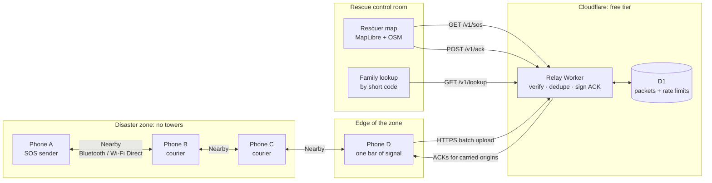

# Setu

**An offline SOS mesh for Android: when every tower is down, phones pass your location hand to hand until one of them finds the internet.**

[](.github/workflows/ci.yml)
[](gradle/libs.versions.toml)
[](app/build.gradle.kts)
[](relay/wrangler.toml)
[](map/index.html)
[](docs/PROTOCOL.md)
[](LICENSE)

*Setu* means "bridge" in Sanskrit. During floods, cyclones, landslides and
network shutdowns, people in the worst-hit zone still hold charged phones but
have no signal. Setu turns each of those phones into a relay. One button sends a
150-byte signed SOS carrying position, headcount and needs. It hops over
Bluetooth and Wi-Fi Direct from phone to phone, reaches a rescuer's map as soon
as any carrier gets online, and returns an acknowledgement through the mesh. No
servers in the zone, no accounts and no special hardware.

---

## Contents

| Section | |
|---|---|
| [What it does](#what-it-does) | Capabilities, by area |
| [Architecture](#architecture) | How the pieces fit |
| [How an SOS travels](#how-an-sos-travels) | From a roof to a rescue boat and back |
| [Quick start](#quick-start) | Build, simulate, run the relay and the map |
| [Project status](#project-status) | Every milestone, and what is still open |
| [Design decisions](#design-decisions) | The tradeoffs, and why |
| [Repository layout](#repository-layout) | Where things live |
| [Documentation](#documentation) | Which file answers which question |
| [Team](#team) | Who built it |

---

## What it does

| Area | Capabilities |
|---|---|
| **SOS** | One-tap SOS with headcount, needs (water, food, medical, trapped, evacuate), battery and a short note. Re-sent every 10 minutes until you press *I'm safe* |
| **Mesh** | Google Nearby Connections (`P2P_CLUSTER`) over Bluetooth, BLE and Wi-Fi Direct. Epidemic store-and-forward with a bloom filter, TTLs, a 32-hop limit and priority SOS > ACK > SAFE |
| **Courier mode** | Any phone can carry other people's packets without sending its own. A foreground service restarts on boot |
| **Battery** | The radio duty cycle follows battery level, from 20 s scanning every minute above 50 % to one 10 s scan every 7 minutes below 15 %. An active SOS forces the top tier |
| **Integrity** | Every packet is signed with Ed25519 by its origin key and verified on every hop and at the relay. The packet id is the SHA-256 of the signed body, so copies are recognised as duplicates |
| **Relay** | Cloudflare Worker and D1 with no runtime dependencies. Upload, verify, dedupe, rate limit, sign ACKs and run an hourly purge |
| **Rescuer map** | MapLibre and OpenStreetMap. Clusters, a triage-ordered list, *Mark reached*, CSV export and a mobile bottom sheet |
| **Families** | A six-character code such as `47Z-33Q` on the sender's screen. Anyone can look it up, and positions are rounded to about 1 km |
| **Open protocol** | A CBOR wire format with a published spec and test vectors that Kotlin and TypeScript agree on byte for byte |

---

## Architecture

Every phone runs the same code. There is no coordinator, no leader election and no
identity server. The only fixed infrastructure is a relay outside the
disaster zone, and anyone can deploy one in five minutes.



`protocol` and `routing` are pure Kotlin with no Android imports. The phone
app, the simulator and any future LoRa bridge or desktop gateway all run the
same code for packets and routing.

---

## How an SOS travels

```mermaid
sequenceDiagram
    participant A as Phone A (SOS)
    participant B as Phone B (courier)
    participant D as Phone D (online)
    participant R as Relay
    participant M as Rescuer map

    A->>A: sign SOS (Ed25519), store
    A->>B: HELLO {bloom of ids I hold}
    B-->>A: HELLO {bloom}
    A->>B: packets B lacks, SOS first
    B->>B: verify signature, TTL, hops; store
    B->>D: same exchange, hours later, across town
    D->>R: POST /v1/upload (CBOR batch)
    R->>R: verify, dedupe, rate limit, store
    M->>R: GET /v1/sos
    R-->>M: open requests, triage order
    M->>R: POST /v1/ack (rescuer token)
    R->>R: sign ACK with relay key
    D->>R: next upload
    R-->>D: ACKs for origins it carries
    D->>B: ACK spreads through the mesh
    B->>A: ACK
    Note over A: "Rescuers have your location"
```

A phone never has to know the route. Every phone offers each neighbour the
packets that neighbour lacks, and the bloom filter keeps each exchange to a few
kilobytes.

---

## Quick start

> Deploying a relay for real? Follow [relay/README.md](relay/README.md).
> Planning a drill? Follow [docs/FIELD_TEST.md](docs/FIELD_TEST.md).

```bash
# 1 · build and test everything (JDK 17, Android SDK platform 37)
./gradlew :protocol:test :routing:test :sim:test :app:testDebugUnitTest :app:assembleDebug

# 2 · install on two or more phones
adb install app/build/outputs/apk/debug/app-debug.apk

# 3 · watch 300 virtual phones in a 500 m square, with 2 % online at any moment
./gradlew :sim:run --args="--nodes 300 --minutes 60"
./gradlew :sim:run --args="--sweep nodes=50,100,200,300 --csv"

# 4 · run the relay locally (Node 22.12+)
cd relay && npm ci
printf 'RELAY_SEED=%s\nRESCUER_TOKEN=local-token\n' "$(openssl rand -hex 32)" > .dev.vars
npm run db:migrate:local && npm run dev            # http://127.0.0.1:8787

# 5 · open the rescuer map against it, with demo data
SETU_SEED_URL=http://127.0.0.1:8787 npm test        # 40 demo SOS around Bengaluru
cd ../map && npm ci && npm run serve                 # http://localhost:8080/?relay=http://127.0.0.1:8787
```

Signed release APKs are attached to each [GitHub release](https://github.com/guru-bharadwaj20/Setu/releases),
each with a `.sha256` file.

---

## Project status

**v0.1.0, released.** All ten planned milestones are complete in code. Field
testing on real phones has not started yet.

```mermaid
gantt
    title Delivery: milestones 1 to 10 complete
    dateFormat X
    axisFormat %s
    section Core
    1 · Protocol: packet, CBOR, Ed25519, short codes   :done, 0, 1
    2 · Routing: bloom, store, router, duty cycle      :done, 1, 2
    3 · Simulator: virtual phones, sweeps, CSV         :done, 2, 3
    section Phone
    4 · App: SOS, courier, status, Room queue          :done, 3, 4
    5 · Mesh transport: Nearby, foreground service    :done, 4, 5
    6 · Drain and ack: connectivity, uploader         :done, 5, 6
    section Outside the zone
    7 · Relay: Workers + D1                           :done, 6, 7
    8 · Rescuer map and family lookup                 :done, 7, 8
    section Ship
    9 · Threat model, lint, CI, fixes                 :done, 8, 9
    10 · Docs, licence, policies, v0.1.0              :done, 9, 10
```

| # | Milestone | Tests | Status |
|---|---|:---:|:---:|
| 1 | Protocol: packet model, canonical CBOR, Ed25519, Crockford short codes | ✅ shared vectors | ✅ |
| 2 | Routing: bloom filter, bounded store, epidemic router, duty cycle | ✅ | ✅ |
| 3 | Simulator: discrete-event, mobility, sweeps | ✅ | ✅ |
| 4 | App: Compose UI, Room queue, identity in Keystore | ✅ | ✅ |
| 5 | Mesh transport: Nearby Connections, foreground service, boot | lint only | ✅ awaiting phones |
| 6 | Drain and ack: connectivity watcher, uploader, ACK injection | ✅ | ✅ |
| 7 | Relay: upload, verify, dedupe, ACK, lookup, rate limit, purge | ✅ 20 + e2e | ✅ |
| 8 | Rescuer map: clusters, triage, reached, CSV, family lookup | ✅ 8 | ✅ |
| 9 | Security and quality: threat model, lint clean, CI, CodeQL | ✅ | ✅ |
| 10 | Release: README, licence, code of conduct, security policy | — | ✅ v0.1.0 |

In the simulator, 300 phones in a 500 m square with 30 m radio range and 2 % of
phones online delivered **30 of 30 SOS** in a median of **30 s** (p90 45 s).
Every sender got its ACK back, at a mean battery cost of about 2 % per hour.

**Four things remain open:**

| # | Item | Why it is not closed |
|---|---|---|
| 1 | Field test on real phones | Needs people and phones, not code. The procedure and drill sheet are in [docs/FIELD_TEST.md](docs/FIELD_TEST.md) |
| 2 | Pin the relay key for ACKs | v0.1.0 accepts an ACK from any signer ([threat model T5](docs/THREAT_MODEL.md)). Planned for v0.2 |
| 3 | Per-brand background guide | Some Android brands stop foreground services anyway. Which brands do so has to be measured in the field |
| 4 | iOS | iOS does not allow background relaying. The open protocol leaves room for a foreground-only port |

### What CI proves on every push

| Job | Proves |
|---|---|
| `android` | Protocol, routing, simulator and app unit tests pass. Lint is clean, the debug APK builds, and a 200-phone simulator run completes |
| `relay` | Strict TypeScript typecheck and Vitest: packet codec, routes and the shared byte-level vectors |
| `map` | Triage, CSV injection defence, GeoJSON order, code normalisation, relay URL sanitising |
| `codeql` | Security-and-quality queries over the TypeScript, JavaScript and workflows (runs once the repo is public) |
| `release` | On a `v*` tag, runs the tests again and builds an R8-minified APK signed with the release key. Publishes it with its SHA-256 |

---

## Design decisions

**Epidemic routing, not routing tables.** In a disaster, links last seconds and
the topology changes every minute. Any protocol that discovers routes is
always out of date. Copying every live packet to every neighbour wastes radio
time, but packets are 150 bytes, and wasted copies are exactly what get a
packet through a network nobody can map.

**Signed, not encrypted.** An SOS is meant to be read by any rescuer, so secrecy
would only get in the way. What matters is that nobody can move your pin or
speak as you. Ed25519 gives that in 64 bytes with no key exchange and no
identity server.

**CBOR with integer keys, not JSON.** The same SOS takes well under half the bytes of JSON.
Smaller packets survive short, flaky Bluetooth links. The encoding is canonical, so
the id (a hash of the body) is identical on every phone and at the relay.

**Nearby Connections, not raw BLE.** Nearby Connections picks Bluetooth, BLE or
Wi-Fi Direct, handles pairing-free connections and runs on any phone with Play
services. Raw BLE would reach slightly more devices, at the cost of months of
radio work on each phone brand.

**A bounded store with priority eviction.** A phone holds at most 2000 packets.
It drops expired packets first, then SAFE, then ACK, then the most-travelled SOS. A
flood can push out stale packets, but it cannot push out the newest calls for
help nearby.

**Serverless relay, not a server.** A Worker and D1 database cost nothing
when idle and scale when a disaster suddenly brings traffic. Anyone can deploy
their own with four commands. The relay has no runtime dependencies to audit.

**(0, 0) means "no fix".** An SOS should never wait for GPS. The phone sends
straight away without a position, tells the user, and adds the position on the next
re-send. The relay returns `null` and the map lists that SOS without plotting it.

---

## Repository layout

```
.
├── protocol/   pure Kotlin: packet model, canonical CBOR, Ed25519 identity, short codes
├── routing/    pure Kotlin: bloom filter, bounded store, epidemic router, duty cycle
├── sim/        discrete-event simulator, hundreds of virtual phones on a laptop
├── app/        Android app: Compose UI, Room queue, Nearby transport, mesh service, uploader
├── relay/      Cloudflare Worker + D1 schema, zero runtime dependencies
├── map/        static rescuer map and family lookup (MapLibre + OSM)
├── docs/       requirements, architecture, protocol, threat model, field test, vectors
└── .github/    CI, signed release, CodeQL, Dependabot, issue forms
```

---

## Documentation

| Question | File |
|---|---|
| *Why does this exist, and for whom?* | [docs/REQUIREMENTS.md](docs/REQUIREMENTS.md) |
| *How do the pieces fit?* | [docs/ARCHITECTURE.md](docs/ARCHITECTURE.md) |
| *What is on the wire?* | [docs/PROTOCOL.md](docs/PROTOCOL.md), with test vectors in [docs/vectors/](docs/vectors/) |
| *What can an attacker do?* | [docs/THREAT_MODEL.md](docs/THREAT_MODEL.md) |
| *How do I run a drill?* | [docs/FIELD_TEST.md](docs/FIELD_TEST.md) |
| *How do I deploy a relay?* | [relay/README.md](relay/README.md) |
| *What was the plan?* | [docs/PLAN.md](docs/PLAN.md) |
| *What changed?* | [CHANGELOG.md](CHANGELOG.md) |
| *I found a vulnerability* | [SECURITY.md](SECURITY.md) |

---

## Before you rely on it

> [!CAUTION]
> **1. Setu does not replace emergency services.** It is experimental and has not yet been field-tested.
> If you can reach 112 (India) or your local emergency number, do that first.
>
> **2. The release keystore cannot be replaced.** If it is lost, no update can ever install over
> existing copies of the app. Phones would have to uninstall, which deletes the packets they carry.
>
> **3. The relay's `RELAY_SEED` must not change.** Phones in the field hold ACKs signed with it.
> Keep it in a password manager and **on paper**, together with the rescuer token.

---

## Team

| Member | Focus |
|---|---|
| **Guru R Bharadwaj** | Protocol, routing, simulator, Android app, relay, rescuer map |

Want to help? Field test reports are the most valuable contribution right now.
Use the *Field test report* issue form. Please follow the
[Code of Conduct](CODE_OF_CONDUCT.md).

---

## License

Code: [Apache License 2.0](LICENSE). Documentation in `docs/`: also available under
[CC BY 4.0](https://creativecommons.org/licenses/by/4.0/). Third-party notices are in [NOTICE](NOTICE).
